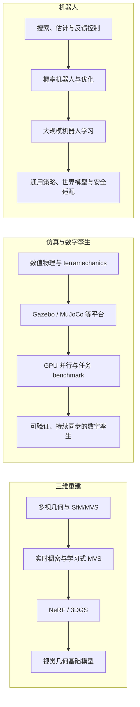

# 2026-08-31 三维重建—仿真—机器人研究雷达

本轮研究使用仓库内的 `planetary-3d-robotics-radar`，并用 `nature-academic-search` 的多源检索与核验规则补充证据。

## 研究边界

- 检索日：2026-08-31
- 主窗口：2024-09-01 至 2026-08-31
- 经典线：不受两年窗口限制，只保留建立学科范式、能解释当前路线来源的里程碑
- 窗口前锚点：仅用于连接经典线和当前前沿，并在正文明确标注，不计入“近两年代表作”
- 三个独立主题：三维重建；仿真与数字孪生（重点含月球/火星）；机器人学
- 证据优先级：官方会议/出版社页面与 DOI 记录优先，arXiv 只作为全文或 emerging 证据

## 三条独立发展线

## 术语口径

| 规范术语 | 本轮含义 | 使用决定 |
|---|---|---|
| 三维重建 | 从观测恢复相机、几何、外观或动态；具体任务另行说明 | 不把新视角合成默认等同于 metric reconstruction |
| 视觉几何基础模型 | 共享模型统一处理相机、深度、pointmap、track 等几何任务 | 不用“3D foundation model”泛指所有大模型 |
| 仿真 | 给定模型与输入后预测系统/观测行为 | 与数字孪生分开使用 |
| 数字孪生 | 能被现实数据持续更新，并反向服务预测或决策的虚拟系统 | 固定 CAD/场景不称为数字孪生 |
| 通用机器人策略 | 跨任务、场景或机器人使用的 policy | 不默认等同于 VLA；非语言 generalist 也可纳入 |

## 文件导航：先分方向，再做交叉

- [方向一：三维重建](01-3d-reconstruction.md)：多视几何至视觉几何基础模型的经典脉络、近两年代表作、四篇简读和六个课题
- [方向二：仿真与数字孪生](02-simulation-digital-twins.md)：terramechanics、机器人仿真平台、月/火星环境、数字孪生的经典脉络与近期研究
- [方向三：机器人](03-robotics.md)：搜索、估计、规划、控制、学习、VLA、触觉和安全适配的独立机器人学路线
- [三方向交叉机会](04-cross-track-opportunities.md)：两两交叉矩阵、三者闭环、项目优先级与伪交叉警示
- [全局排序论文雷达](ranked-radar.md)：跨目录的统一评分索引，不代替三个独立方向分析
- [原交叉方向论文 Reading](paper-readings.md)：保留首轮交叉选文；三个独立方向的新简读已写回各自章节
- [原交叉研究方案](research-directions.md)：五个完整实验模板，现作为第四层的扩展材料
- [检索日志](query-log.md)：查询族、来源覆盖、失败与去重规则
- [机器可读目录](../../planetary-3d-robotics-radar/references/paper-catalog.json)：36 篇结构化论文记录

## 本轮结论

三个方向各自都存在可独立发表的问题，不能只按交叉价值筛选。独立方向优先项为：

1. **三维重建**：显式失败验证、固定内存流式模型、几何—外观—动态可分离表示、风险保持压缩、主动采集、长期版本化地图；
2. **仿真**：带适用域的多保真模型、逆仿真与可辨识性、任务误差驱动校准、可回滚数字孪生、极端环境 benchmark、动态保真调度；
3. **机器人**：可靠通用策略、预算公平数据引擎、语义世界模型与可验证控制接口、接触基础策略、持续适配、具身设计—控制—学习联合优化。

这些方向先按各自学科价值成立，再考虑两两交叉和三者闭环。交叉文档不再反向决定三篇独立综述的选文。

## 重要限制

本轮是代表性发展脉络综述，不是 PRISMA 系统综述。文献发现与核验使用官方会议、出版社、DOI、arXiv 和广域检索；“代表性”综合考虑范式影响、venue/奖项、当前路线关联和证据可得性，不等于穷尽式收录。未检出只表示本轮没有发现，不能当作不存在的证据。
